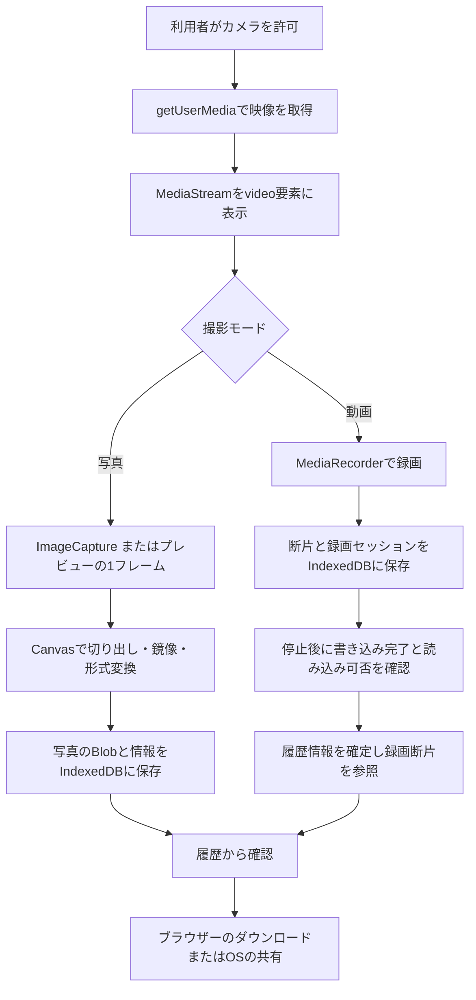

# 構成と処理の流れ

[READMEへ戻る](../README.md)

この資料は、公開版のソース `9922270` を読み始めるための案内です。コード上の役割分担と処理の流れを説明しており、自動試験の結果や実機での動作確認とは区別しています。確認範囲は[検証記録](verification.md)、利用者向けの操作手順は[使い方](usage.md)を参照してください。

## 全体像

Quiet CameraはHTML・CSS・JavaScriptで構成されたブラウザーアプリです。`index.html` が画面構造を定義し、複数のJavaScriptファイルを順番に読み込みます。カメラ映像の取得、録画、保存領域の管理、ファイル共有にはブラウザーAPIを使用しています。PWA用のマニフェストとService Workerも含まれています。

HTMLはボタンや設定欄などの構造と意味、CSSはレイアウト・配色・縦横表示の見た目、JavaScriptは操作に応じた状態変更とAPI呼び出しを担当します。CSSで画面上の映像の見せ方を変える処理と、保存されるファイル自体の画素を加工する処理は別です。写真ではCanvasを使って表示枠の保存範囲を切り出し、動画では取得したストリームを `MediaRecorder` に渡して記録します。

実装の根拠：[画面とスクリプトの読み込み順](https://github.com/tomoponz/quiet-camera/blob/9922270df2939db95a9835f9875e087e028b0420/index.html#L304-L325)、[写真の出力](https://github.com/tomoponz/quiet-camera/blob/9922270df2939db95a9835f9875e087e028b0420/photo.js#L183-L257)、[録画の開始](https://github.com/tomoponz/quiet-camera/blob/9922270df2939db95a9835f9875e087e028b0420/video.js#L353-L465)。

## 主要ファイル

| ファイル | 主な役割 |
| --- | --- |
| [`index.html`](../index.html) | 撮影画面、設定、履歴、確認ダイアログの構造とスクリプトの読み込み順。 |
| [`core.js`](../core.js) | DOM要素の参照、共有状態、初期設定、撮影モード、比率、基本UIの管理。 |
| [`camera-devices.js`](../camera-devices.js) | カメラ・マイクの取得要求、カメラ一覧の取得、起動・切替・失敗時の処理。 |
| [`camera-controls.js`](../camera-controls.js) | ズーム、ピント、露出補正、ライトの要求と対応機能の確認。 |
| [`camera-enhancements.js`](../camera-enhancements.js) | 拡張されたカメラ処理と画面イベントの接続、履歴の読み込み。 |
| [`camera-transition.js`](../camera-transition.js) | カメラ切替時の一時表示、操作の抑止、ストリームを再利用できる条件の判定。 |
| [`photo.js`](../photo.js) | 写真の取得・切り出し・画像形式変換、PDF作成、確認対象の切替。 |
| [`video.js`](../video.js) | 録画、容量・時間の制限、一時データの管理、保存確定、中断録画の復元処理。 |
| [`storage.js`](../storage.js) | IndexedDBの撮影データと録画断片、設定保存、保存容量の問い合わせ。 |
| [`ui.js`](../ui.js) | アプリ初期化、共有・ダウンロード・削除、Service Workerの登録。 |
| [`photo-review.js`](../photo-review.js) | 詳細画面での写真・動画の前後移動とスワイプ操作。 |
| [`gallery-selection.js`](../gallery-selection.js) / [`gallery-batch.js`](../gallery-batch.js) | 履歴の複数選択、一括での保存・共有・削除、ZIP生成。 |
| [`camera-overlay.js`](../camera-overlay.js) / [`device-layout-model.js`](../device-layout-model.js) | 端末の向きと表示領域に応じた、映像枠や操作部の位置計算。 |
| [`camera-overlay.css`](../camera-overlay.css) / その他のCSS | 計算された位置の画面反映、撮影画面・設定・履歴のスタイル定義。 |
| [`service-worker.js`](../service-worker.js) / [`manifest.webmanifest`](../manifest.webmanifest) | アプリ資材のキャッシュとPWA定義（撮影履歴の保存先とは別）。 |

各スクリプトはES Modulesとして分離されておらず、`elements`、`state`、`QuietCameraEnhancements` などをグローバル領域を介して共有するため、読み込み順に意味があります。特に `core.js` の基本カメラ処理は、後から読み込む `camera-enhancements.js` が拡張版へ接続し直す仕組みになっています。そのため、`core.js` だけを読んで現在の動作を判断しないよう注意してください。また、`camera-capture.js` は写真処理を接続する薄い窓口であり、撮影処理の本体は `photo.js` にあります。

実装の根拠：[拡張処理への接続](https://github.com/tomoponz/quiet-camera/blob/9922270df2939db95a9835f9875e087e028b0420/camera-enhancements.js#L84-L100)、[写真処理の接続](https://github.com/tomoponz/quiet-camera/blob/9922270df2939db95a9835f9875e087e028b0420/camera-capture.js#L1-L10)。

## 撮影から保存まで

### 写真

`ImageCapture.takePhoto()` が利用可能であれば静止画を取得し、利用できない場合や失敗した場合は現在のプレビュー映像の1フレームから画像を作ります。画面の保存範囲に合わせて中央を切り出し、自撮りの鏡像設定を反映した後、Canvasから画像の `Blob` を生成します。実際の画像形式はブラウザーの対応に依存します。PDF選択時は画像をPDFに組み込みます。履歴（IndexedDB）への保存と、端末へのファイルダウンロードは別の処理です。

### 動画

`MediaRecorder` にストリームを渡し、録画中に生成される断片（チャンク）をIndexedDBへ順次書き込みます。停止後は書き込みの完了を待ち、断片から組み立てた動画をブラウザーで読み込めるか確認したうえで履歴情報を確定します。この確認は読み込み可否のチェックであり、動画全編の再生品質や音声同期まで保証するものではありません。

確定した動画の履歴記録は、保存済みの断片を参照する形で保持し、大きな `Blob` の二重保存を避けています。閲覧やファイル取り出しの際には、断片から一時的に `Blob` を組み立てるため、メモリを使います。保存確定前に中断したデータには復元経路がありますが、保存できたデータや読み込み確認の結果によっては復元できません。容量制限、復元、一時データの扱いは[データと権限](data-and-permissions.md)にまとめています。

実装の根拠：[写真の取得と保存](https://github.com/tomoponz/quiet-camera/blob/9922270df2939db95a9835f9875e087e028b0420/photo.js#L157-L257)、[動画の読み込み確認](https://github.com/tomoponz/quiet-camera/blob/9922270df2939db95a9835f9875e087e028b0420/video.js#L312-L349)、[動画の保存確定](https://github.com/tomoponz/quiet-camera/blob/9922270df2939db95a9835f9875e087e028b0420/video.js#L509-L588)、[断片を使った読み出し](https://github.com/tomoponz/quiet-camera/blob/9922270df2939db95a9835f9875e087e028b0420/storage.js#L98-L104)、[履歴情報の確定](https://github.com/tomoponz/quiet-camera/blob/9922270df2939db95a9835f9875e087e028b0420/storage.js#L293-L310)。

## ブラウザーAPIとの分担

| API・仕組み | アプリでの用途 | 読むときの注意 |
| --- | --- | --- |
| `getUserMedia` / `MediaStreamTrack` | カメラ・マイク取得と画質・カメラ操作の要求 | 権限、対応機能、取得結果はブラウザーと端末に依存します。要求値がそのまま採用されるとは限りません。 |
| `HTMLVideoElement` | プレビュー表示、保存動画の確認 | プレビューが表示されても保存完了を意味しません。 |
| `ImageCapture` / Canvas / `Blob` | 写真の取得、画素の切り出し、ファイルデータ生成 | CSSで画面上の見え方を変える処理とは区別されます。 |
| `MediaRecorder` | 動画およびマイクON時の音声記録 | コンテナー、コーデック、品質などに環境差があります。 |
| IndexedDB | 履歴、録画断片、録画セッションの保存 | ブラウザーのサイトデータであり、端末の標準写真フォルダーとは別です。 |
| `localStorage` | 一部の撮影設定とカメラ識別子の保存 | マイクのON状態は次回起動へ引き継ぎません。 |
| Web Locks | 録画データを扱う処理の排他制御・競合防止 | 安全な録画と復元に必須のAPIです。非対応環境では録画を開始しません。 |
| `navigator.share` / ダウンロードリンク | 撮影ファイルのアプリ外への取り出し | 保存先や共有先での処理はブラウザー・OS側が担います。 |
| Service Worker / Cache Storage | アプリのHTML・CSS・JavaScriptなどのキャッシュ | 撮影データを保存するIndexedDBとは別です。更新や通信の詳細は[データと権限](data-and-permissions.md)を参照してください。 |

実装の根拠：[データベース定義](https://github.com/tomoponz/quiet-camera/blob/9922270df2939db95a9835f9875e087e028b0420/storage.js#L3-L7)、[設定の保存](https://github.com/tomoponz/quiet-camera/blob/9922270df2939db95a9835f9875e087e028b0420/storage.js#L370-L381)、[Web Locksによる排他](https://github.com/tomoponz/quiet-camera/blob/9922270df2939db95a9835f9875e087e028b0420/video.js#L38-L49)、[取り出し](https://github.com/tomoponz/quiet-camera/blob/9922270df2939db95a9835f9875e087e028b0420/ui.js#L10-L41)。

## 読み始める順序

1. `index.html` で、画面上のボタンや設定欄の要素を確認します。
2. `core.js` で、各要素の参照方法と共有状態の定義を把握します。
3. `photo.js` で、1回の写真撮影が画像データに変換される流れを追います。
4. `storage.js` で、履歴への保存とファイル取り出しの違いを確認します。
5. `video.js` で、動画特有の断片保存と保存確定・復元処理を読みます。
6. カメラ固有の操作は `camera-devices.js` と `camera-controls.js`、画面の縦横レイアウトは `camera-overlay.js` と関連CSSへ進みます。

試験コードの読み方と実行済み範囲は[検証記録](verification.md)、開発に使ったAIなどの記録は[開発とAIの利用](development.md)を参照してください。
